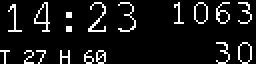

# pico_co2


DIY device that shows CO2 level, temperature, humidity and time.

## Display Themes

Below are examples of the different display themes available:

**Main Display**



**CO2 Graph Display**


## Hardware installation

### Required components

- Board:
    * Raspberry Pico board
- Display:
    * SSD1306 0.96" OLED display
- Sensor CO2, one of following:
    * ENS160 sensor
    * SCD4x sensor
- Source of current time:
    * DS3231
- Touch buttons (2x)

[Read more here](docs/hardware.md).

## Software installation

1. Plug device via USB.
2. Flash firmware: with `make flash`

## How to set up time

On time screen hold both buttons simultaneously.

## Development

### Requirements for vim development

- go version go1.25.9 linux/amd64
- tinygo version 0.39.0 linux/amd64
- go install github.com/sago35/tinygo-edit@latest
- run as `tinygo-edit --target pico --editor nvim --wait`

### Themes preview

```bash
make test-displays
```

This regenerates the active screens and `images/gallery/`, then lists image changes for visual review.

## Alternatives

- https://aranet.com/en/home/products/aranet4-home
- https://www.newentor.com/products/co-monitor-c1
- https://unni.store/products/co2-monitor-carbon-dioxide-detector-0601
- https://www.ikea.com/ph/en/p/alpstuga-air-quality-sensor-smart-70609377/
