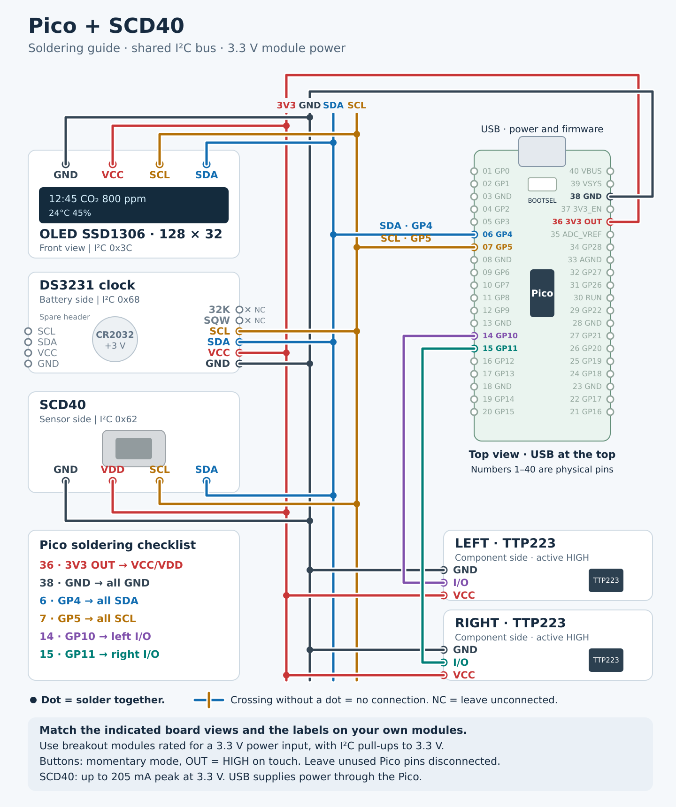
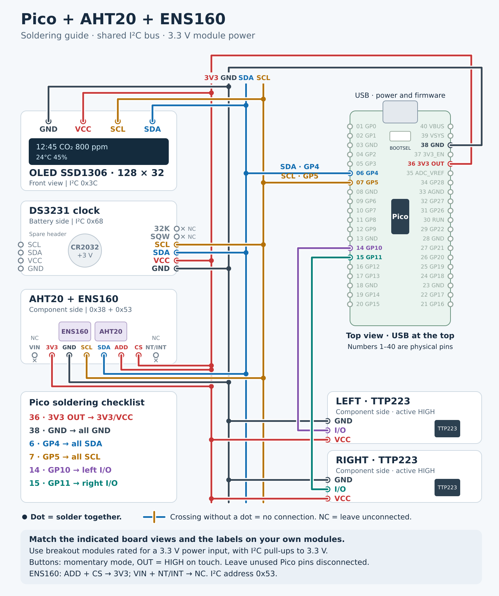

# Wiring diagrams

Both variants use a Raspberry Pi Pico, an **SSD1306 128×32 OLED**, a DS3231 clock and two TTP223 touch buttons. The diagrams show GPIO names and physical Pico pin numbers. Dots mark solder joints; all I²C devices share GP4 (SDA) and GP5 (SCL).

Use breakout modules rated for a **3.3 V power input**, with I²C pull-ups to 3.3 V. Orient each board as shown in the diagram and match the printed pin labels before soldering. Leave DS3231 pins 32K and SQW unconnected. Buttons must be active HIGH in momentary mode.

## SCD40

The SCD40 measures CO₂, temperature and humidity.



Flash from the repository root:

```sh
make flash DEVICE=pico_scd40
```

## AHT20 + ENS160

The AHT20 measures temperature and humidity; the ENS160 estimates **eCO₂** from volatile organic compounds. The diagram shows a combined module; separate boards connect in parallel to the same four nets. The ENS160 must use I²C address **0x53**; the AHT20 uses **0x38**.

On the pictured eight-pin board, connect **3V3, ADD and CS to Pico 3V3 OUT**. Leave **VIN and NT/INT unconnected**.



```sh
make flash DEVICE=pico_aht20ens160
```

Flashing requires Go, TinyGo and `make`; the default target is `pico`. Connect the Pico with a USB data cable. For the first flash, hold BOOTSEL while plugging it in, then release the button and run the appropriate command above.

